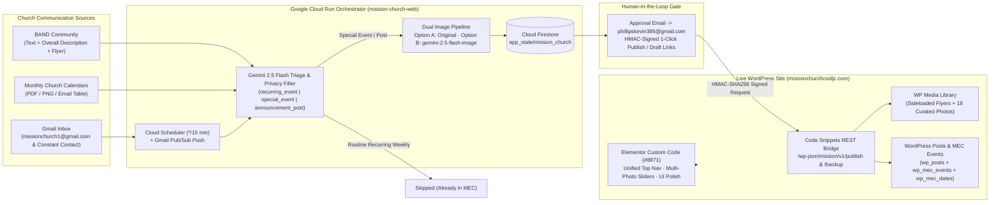

# Mission Church COOLJC — Agentic WordPress Overhaul & Cloud Sync Harness

An **autonomous, AI-orchestrated WordPress wrapper and cloud publishing pipeline** built for **Mission Church of Our Lord Jesus Christ** (`https://missionchurchcooljc.com`, 130 Highland Avenue, Somerville, MA 02143).

- **Live Production WordPress Site:** https://missionchurchcooljc.com
- **Cloud Run AI Orchestrator & Next-Gen MVP Companion Repo:** https://github.com/phillipsk/mission-church-web
- **Live Cloud Run Service URL:** https://mission-church-web-5jdy3d7zua-uc.a.run.app

---

## Why This Harness Exists ("Agentic WordPress Wrapper Architecture")

While evaluating a standalone modern native web architecture (`phillipsk/mission-church-web` on Google Cloud Run + Firestore, running at ~\$0.14/month idle), the church board opted to **preserve `missionchurchcooljc.com` on WordPress + Elementor** while refreshing its design, security posture, and content workflow.

Instead of abandoning the Google Cloud AI backend or manually copying monthly calendars and event flyers into WordPress every week, this project turns the Cloud Run Node.js + Gemini 2.5 Flash service into an **Agentic Automation & UI Harness** that wraps WordPress (`missionchurchcooljc.com`):

1. **Automated Email, Flyer & Calendar Triage (Every 15 Minutes):** Cloud Scheduler (`mission-church-watch-poll`) + Gmail Pub/Sub watch incoming emails from `missionchurch1@gmail.com`, Constant Contact bulletins, and BAND community updates.
2. **Smart Classification (`recurring_event` vs. `special_event` vs. `announcement_post`):**
   - **`recurring_event`:** Routine weekly services already on Modern Events Calendar (Sunday Worship `12 PM`, Monday `6:30 AM` Prayer, Tue–Thu `7 AM` Prayer Line, Tuesday `7:30 PM` Bible Study) are automatically separated and **skipped** to prevent duplicate clutter.
   - **`special_event`:** Net-new dated ministry gatherings, monthly `Shepherd's Kitchen` dates, guest speakers, and fellowships target **both WordPress Posts and Modern Events Calendar (`mec-events`)**.
   - **`announcement_post`:** General news, building fund updates, or BAND highlights target **WordPress Posts only** (`createMecEvent: false`).
3. **Privacy-Preserving Copy Sanitization:** Deterministic + LLM rules strip regular lay participant contact info (`Brother X` / `Sister Y`, personal emails/phones) while preserving billed clergy and speakers (`Bishop`, `Pastor`, `Apostle`, `Elder`, `First Lady`, etc.).
4. **Dual Image Studio + 1-Click HMAC Publishing:** Each event pairs **Option A (Original Flyer)** with **Option B (Gemini 2.5 Flash bespoke editorial graphic)** and emails an HTML approval card to `phillipskevin386@gmail.com`. Clicking **Publish** pushes media, Gutenberg post HTML, and M.E. Calendar date/time database rows over an HMAC-SHA256 authenticated REST bridge (`/wp-json/mission/v1/publish`)—bypassing Sharefaith MU-plugin restrictions on WordPress Application Passwords and WP REST meta limitations on MEC schedules.
5. **Full-Site WordPress Overhaul & Elementor UI Parity Engine:** Reorders top navigation above hero imagery across every inner page, upgrades static legacy banners into curated **Multi-Photo Ken-Burns Hero Sliders**, enriches 10 previously empty ministry accordion tabs, eliminates 4 zero-usage plugins (`0` known vulnerabilities via `WPVulnerability`), fixes mobile layout collisions, and standardizes the footer.

---

## System Architecture



---

## Key Overhaul Results (Before vs. After)

| Area | Before Overhaul | After Overhaul |
| :--- | :--- | :--- |
| **Security & Updates** | Outdated `Modern Events Calendar Lite` (`7.37.0`) & themes; persistent `Ekklesia360` admin error banner | **All plugins & themes current (`0` updates pending)**; **`0` known vulnerabilities** (`WPVulnerability 5.1.6`); `Ekklesia360` deactivated |
| **Plugin & Theme Footprint** | `24` active plugins (4 with `0` usage across all 14 pages, 106 posts, 110 events); 5 installed themes | **`20` Active / `4` Inactive** audited candidates ([HTML Report](./reports/deactivated-plugins-and-drafts-report.html)); **2 clean themes** (`Hello Elementor` + `Twenty Twenty-Five` fallback) |
| **Timezone & Site Health** | Manual `UTC-4` offset causing M.E. Calendar DST warnings | Configured to **`America/New_York`**; WordPress Site Health **`Good` (`0` Critical Issues)** |
| **Header & Hero Parity** | Inner pages placed Nav Menu *below* single static thumbnails (some still using 2022 Good Friday flyers); `/ministries/` missing hero heading | **Unified Top Navigation Bar** above a curated **Multi-Photo Ken-Burns Hero Slider** (`18` freshly uploaded congregation photos) on every inner page |
| **Page-by-Page UX & Content** | `/ministries/` `"Why We Serve"` mobile `-30px` overlap + 10 empty accordion tabs; typos on `/`, `/give/`, `http://` YT thumbs on `/message-nuggets/`; broken `mailtoMISSIONCHURCH1@...` & `© 2025` footer | Clean **`+12px` mobile spacing**; **all 10 ministry tabs enriched** with copy, schedules & CTAs; typos & HTTPS fixed; `/contact/` info card added; global **`mailto:missionchurch1@gmail.com` & `© 2026`** footer parity |
| **Cloud Publishing Bridge** | Blocked by Sharefaith MU-plugin stripping WP Application Passwords & MEC REST omitting dates | **HMAC-SHA256 `/wp-json/mission/v1/publish`** (`Code Snippets` Bridge) atomically uploads media, creates posts, and populates `wp_mec_events` / `wp_mec_dates` |

---

## Repository Structure

```text
mission-wp-agentic-harness/
├── README.md                                        # Architecture & overhaul documentation
├── .gitignore                                       # Blocks .env, secrets, and local keys
├── wordpress-plugin/
│   └── mission-church-cloud-sync.php                # Secret-free PHP REST bridge (/wp-json/mission/v1/publish & /backup)
├── wordpress-ui/
│   └── mission-elementor-ui-overhaul.html           # Sitewide Elementor Custom Code CSS + JS overhaul engine
├── cloud-orchestrator/
│   ├── wordpress-publisher.js                       # Calendar/flyer Gemini triage, privacy redaction, dual images & WP bridge client
│   └── sync-pipeline.js                             # Gmail Watch, BAND ingest, approval emailer & recurring-event filter
└── reports/
    └── deactivated-plugins-and-drafts-report.html   # Interactive HTML audit report with plugin homepage URLs & draft preview links
```

---

## Relationship Between Repositories

- **[phillipsk/mission-wp-agentic-harness](https://github.com/phillipsk/mission-wp-agentic-harness)** *(this repository)*: WordPress-focused overhaul assets, Elementor sitewide enhancement layer, PHP HMAC sync bridge, interactive plugin/draft review report, and synced cloud triage modules.
- **[phillipsk/mission-church-web](https://github.com/phillipsk/mission-church-web)**: Live Google Cloud Run deployment (`Dockerfile`, GitHub Actions CI/CD, Cloud Firestore store, `/login` Admin Studio, AI Concierge, native Board-reviewed white multi-page MVP, and active 15-minute `mission-church-watch-poll` runtime costing **~\$0.14/month idle**).

---

## Security Hygiene

No API keys, WordPress credentials, OAuth refresh tokens, or HMAC secrets are committed to this repository. Runtime secrets (`MISSION_APPROVAL_SECRET`, `MISSION_CHURCH_GEMINI_API_KEY`, `MISSION_GMAIL_*`) live exclusively inside **Google Cloud Secret Manager** (`gen-lang-client-0150678391`) and WordPress server configuration.
